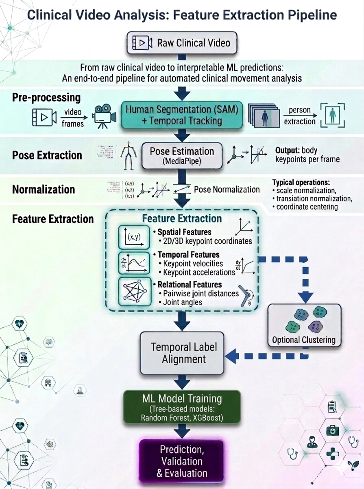
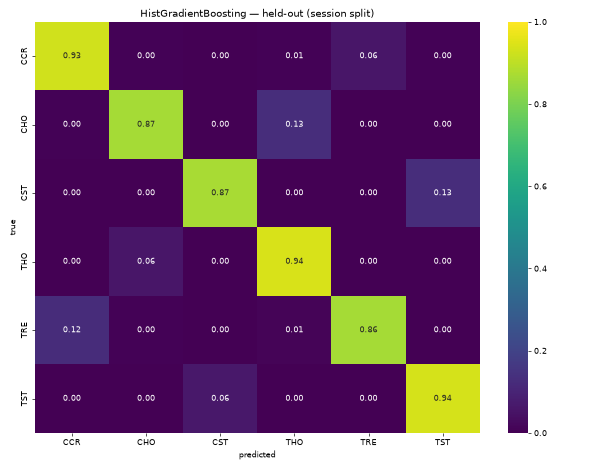
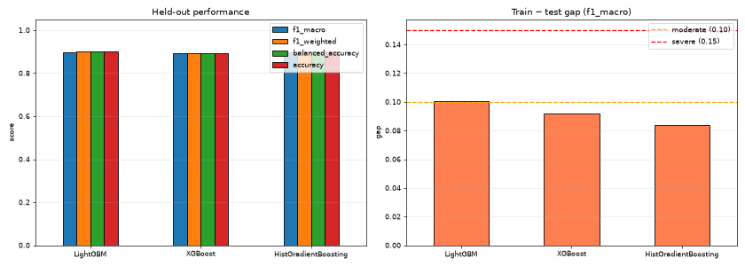
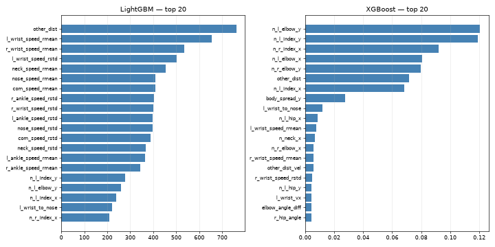
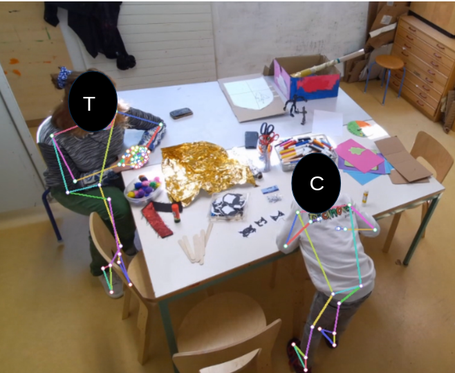

# Clinical Video ML Pipeline for Behavioural Analysis

[](../../actions/workflows/ci.yml)

A reproducible pipeline for **batch analysis of therapy-session videos**,
developed for applied ML work with clinical video data at Lausanne
University Hospital (CHUV).

It takes raw session videos, tracks every person (SAM3) and estimates their
pose (MediaPipe, via [psifx](https://github.com/psifx/psifx)), aligns expert
WAKEE annotations to pose frames, and trains gradient-boosted classifiers
that recognise behaviour codes from body kinematics. Predictions are written
back as time-stamped segments that can be reviewed in an annotation tool.



> **Upgrading from v0.1?** Several bugs affected results of the previous
> version (wrong keypoint names, label leakage in temporal features, a
> broken time split). Metrics from v0.1 are not comparable — see
> [CHANGELOG.md](CHANGELOG.md).

---

## Scope

**What it is:** a config-driven *batch* pipeline — raw video → pose tables →
labeled frames → trained model → predictions and evaluation artefacts —
built to be re-run by the research team on new recording sessions.

**What it is not:** a real-time inference service. There is no REST API,
container image, or model registry; these would be the next steps for a
production setting.

---

## Quick start (no GPU needed)

```bash
python -m venv .venv && source .venv/bin/activate
pip install -e ".[dev]"

# synthetic sessions in the exact psifx / WAKEE formats
python scripts/make_demo_data.py demo
vas -c demo/configs/config.yaml run
pytest
```

The demo writes everything under `demo/` (pose tables, labeled frames,
model bundle, predictions, plots).

### Demo results (synthetic data)

Held-out session, 6 behaviour codes. Synthetic poses are easy to separate,
so these numbers show that the pipeline works, not how well it performs on
real recordings.





---

## Pipeline

| Step | Command | What happens | Main output (`outputs/<session>/`) |
|------|---------|--------------|------------------------------------|
| 1 | `vas video` | ffmpeg trim + crop → psifx SAM3 tracking → psifx MediaPipe multi-person pose | `PosesDir/<track>.tar.gz` (in the session folder) |
| 2 | `vas extract` | stream pose archives into one table, label tracks, drop low-visibility keypoints | `processed_data.parquet` |
| 3 | `vas cluster` *(optional)* | movement, proximity, approach → response, lagged correlation, session phases, KMeans pose clusters | `pose_clustering/` |
| 4 | `vas align` | map WAKEE codes to frames of the matching role | `labeled_features.parquet` |
| 5 | `vas train` | features, leakage-safe split, 3-model benchmark, model bundle | `models/model_bundle.joblib`, `outputs/training/` |
| 6 | `vas predict` | frame predictions + contiguous segments; evaluation if annotations exist | `predictions.parquet`, `predicted_segments.csv` |

`vas run` executes all enabled steps for every session. Each step caches its
output; use `--force` to recompute and `--retrain` to retrain. Restrict any
command to specific sessions with `-s <session-name>` (repeatable).

```bash
vas run                               # full pipeline with configs/config.yaml
vas -c my_config.yaml run --retrain
vas extract -s "11-1-2024_#7_INDIVIDUAL_[14]" --force
vas predict --input some_pose_table.parquet --output-dir results/
vas show-config                       # resolved config + absolute paths
```

`python -m vas …` works too.

---

## Data layout

```
data/
├── raw/
│   └── <session>/                       e.g. 11-1-2024_#7_INDIVIDUAL_[14]
│       ├── camera_a.mkv                  raw recording
│       ├── project_config.yaml           per-session overrides (recommended)
│       └── PosesDir/1.tar.gz, 2.tar.gz   written by step 1 (or copied from a GPU machine)
└── annotations/
    └── 11-1-2024_#7_INDIVIDUAL_(14)_WAKEE_….txt
```

* Annotation files are matched by the session-name prefix before `[`/`(`;
  they may also sit inside the session folder, or be named explicitly via
  `annotation_alignment.annotation_file`.
* If a session has no pose archives but an old `processed_data.csv` /
  `processed_data__*.parquet`, that table is used. Tables written by v0.1
  are detected and their keypoint columns are re-mapped (landmarks 26–32 are
  then missing — re-extracting from the archives is better).
* `data/`, `outputs/` and `models/` are git-ignored. **Never commit clinical
  data.**

### Per-session configuration

SAM3 assigns track ids per video, so *who is track 1* differs between
sessions. Put a `project_config.yaml` in each session folder; it is
deep-merged over `configs/config.yaml`:

```yaml
video_processing:
  start_trim_sec: 12.5        # also used to shift pose time back to annotation time
  end_trim_sec: 1710
  x_min: 0
pose_extraction:
  id_to_label: {1: Patient1, 2: Therapist1, 3: Parent}
```

Person labels are mapped to roles (`Child`, `Therapist`) in `roles:`;
annotation codes are mapped to roles by prefix
(`annotation_alignment.label_prefix_map`, `CST → C → Child`). A code is only
ever attached to frames of a person with the matching role.

---

## Method

### Keypoints
psifx's MediaPipe tool writes the 33 MediaPipe Pose landmarks
(`[x, y, visibility] × 33`, pixels). `neck` and `mid_hip` are derived as the
shoulder / hip midpoints. Points with visibility below
`pose_extraction.confidence_threshold` become `NaN`.



### Features (`src/vas/features.py`)
Identical code at training and prediction time; no feature uses the label.

* **Normalised pose** — every keypoint relative to mid-hip, divided by torso
  length (neck ↔ mid-hip): invariant to camera distance and body size.
* **Joint angles** (elbows, shoulders, knees, hips, trunk), **distances**
  (wrist ↔ hip/nose, wrist ↔ wrist, eyes, nose ↔ neck/ankles),
  **left/right symmetry**, **body spread**.
* **Temporal** — computed within continuous track segments (same session and
  person, no gap > `features.max_gap_s`): whole-body velocity in torso
  lengths/s, limb velocities in the body frame, speeds, accelerations and
  rolling mean/std of speeds over `features.rolling_window_s`.
* **Interpersonal** — distance and direction to the nearest other person.
* **Role** one-hot.

Zero-variance and highly correlated (|r| > 0.95) features are removed using
the training split only.

### Evaluation
Neighbouring video frames are almost identical, so a random frame split
grossly overestimates performance. The split is chosen by
`model_training.split_strategy`:

* `session` (default when ≥ 3 sessions): whole sessions are held out — the
  number to report, as it measures generalisation to new recordings;
* `time`: the last `test_size` of each session is held out, with a purge gap
  of `purge_gap_s` around the boundary.

XGBoost's hyper-parameter search uses `GroupKFold` over sessions (or
contiguous time blocks); LightGBM / HistGradientBoosting early-stop on the
time-tail of the training sessions. Classes are balanced with sample
weights. Models are compared on `selection_metric` (default macro-F1, which
is not dominated by the most frequent code); the train–test gap is flagged
as `ok` / `moderate` (> 0.10) / `severe` (> 0.15).

The bundle (`models/model_bundle.joblib`) stores the estimator, the class
names, the exact feature list, feature settings, role map, metrics and
library versions — prediction cannot silently diverge from training.

---

## Outputs

```
outputs/
├── <session>/
│   ├── processed_data.parquet        pose table (one row per person × frame)
│   ├── mass_centers.png
│   ├── labeled_features.parquet      frames with annotation_label
│   ├── annotation_stats.png
│   ├── predictions.parquet           predicted_label, predicted_proba, proba_<code>
│   ├── predicted_segments.csv        person, label, start_s, end_s (original video time)
│   ├── prediction_report.json        if the session is annotated
│   ├── confusion_matrix.png
│   ├── pose_clustering/              optional step 3
│   └── processing_log.log
├── combined_labeled_features.parquet
└── training/
    ├── model_metrics.json            split, per-model metrics, per-class report
    ├── model_comparison.png
    ├── feature_importance.png
    ├── confusion_matrix.png
    └── training_log.log
models/model_bundle.joblib
```

Note that predictions for sessions that were part of the *training* split
are optimistic; use the held-out metrics in `outputs/training/`.

---

## Setup for real data

External tools for step 1 (needed only on the machine that processes video):

* `ffmpeg` / `ffprobe`
* [`psifx`](https://github.com/psifx/psifx) with SAM3 and MediaPipe
  (`pip install -e /path/to/psifx`). Some tracking models need a Hugging
  Face token: `export HF_TOKEN=…` (forwarded as `HUGGINGFACE_HUB_TOKEN`).

Steps 2–6 run on CPU. A common workflow is to run `vas video` on a GPU
workstation, copy the `PosesDir/` folders, and run the rest locally with
`flags.skip_video_processing: true`.

---

## Development

```bash
pip install -e ".[dev]"
pre-commit install        # ruff + nbstripout + large-file guard
pytest                    # ~45 s, synthetic data only
ruff check src tests
```

```
src/vas/
├── cli.py               vas command
├── config.py            loading, validation, per-session overrides, paths
├── video_processing.py  step 1 (ffmpeg + psifx)
├── pose_extraction.py   step 2
├── keypoints.py         MediaPipe / BODY_25 layouts, legacy re-mapping
├── clustering.py        step 3
├── annotations.py       step 4
├── features.py          feature engineering (shared by 5 and 6)
├── train.py             step 5
├── predict.py           step 6
├── pipeline.py          orchestration
└── synthetic.py         synthetic sessions for tests / demo
```

---

## Limitations

* **Identity is configured, not inferred.** Track ids must be mapped to
  people per session (`id_to_label`); SAM3 identity can still switch within
  long videos and should be checked on `Visualizations/tracking.mp4`.
* **Annotation taxonomy is project-specific** (`label_to_class`,
  `label_prefix_map`).
* **2D pose from one camera**: depth, occlusions by the table and
  self-occlusion limit what the features can capture.
* **Not validated on external datasets**; results are in-distribution for the
  CHUV recording setup.
